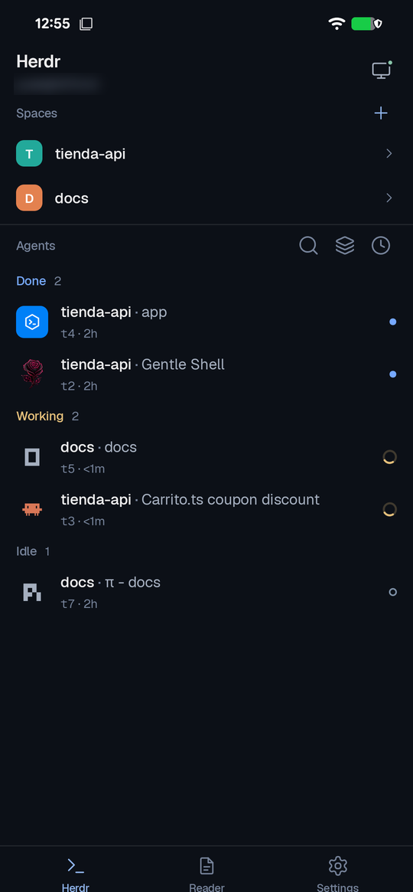
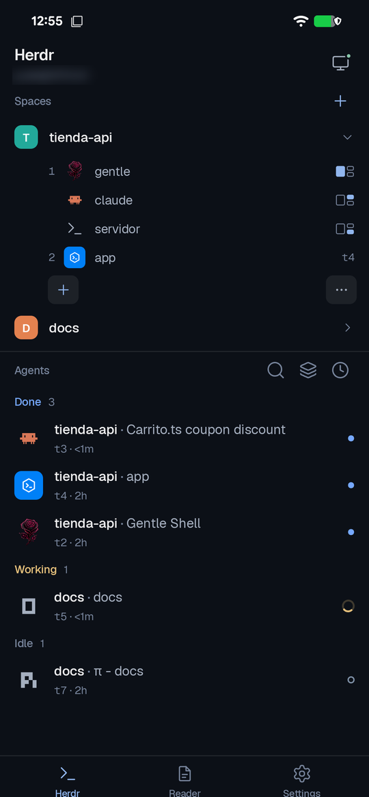
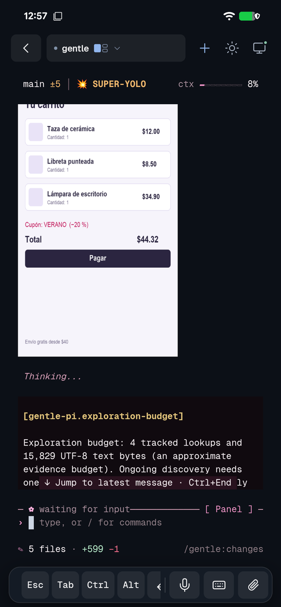
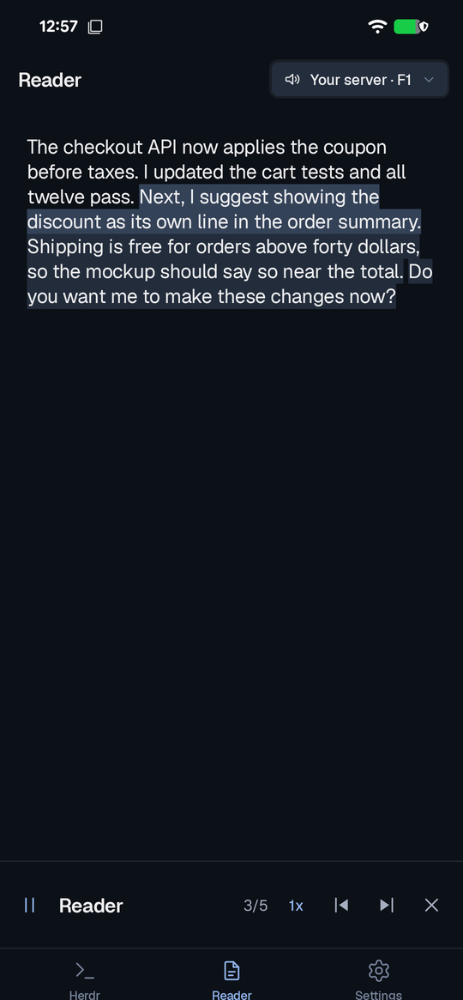
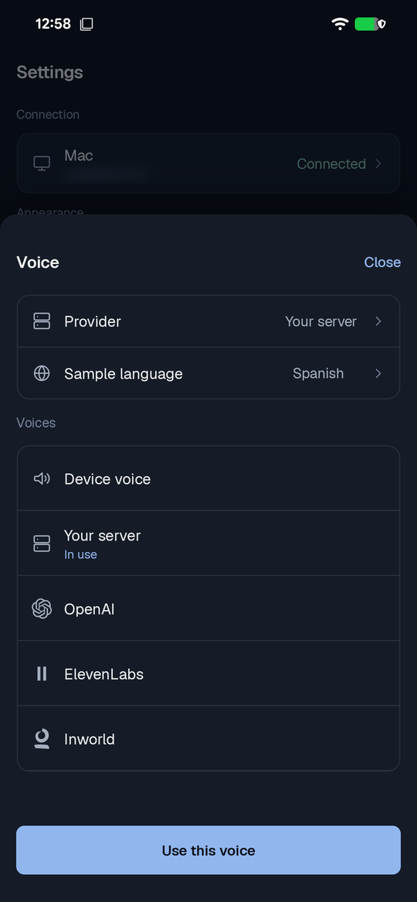
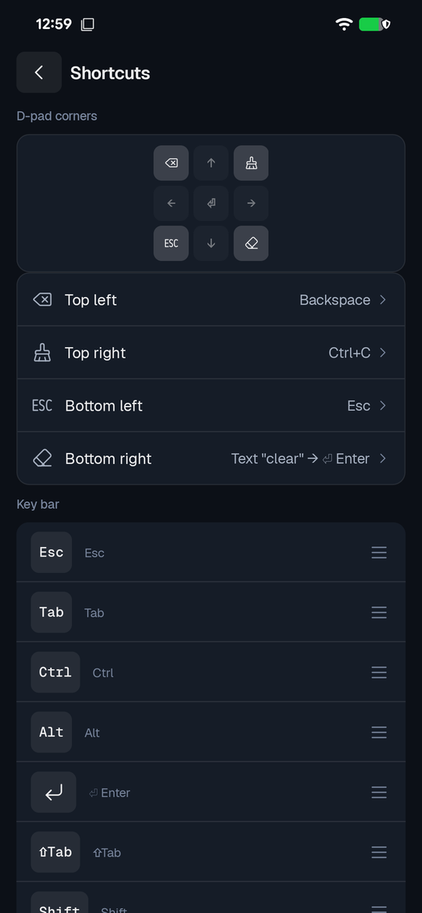
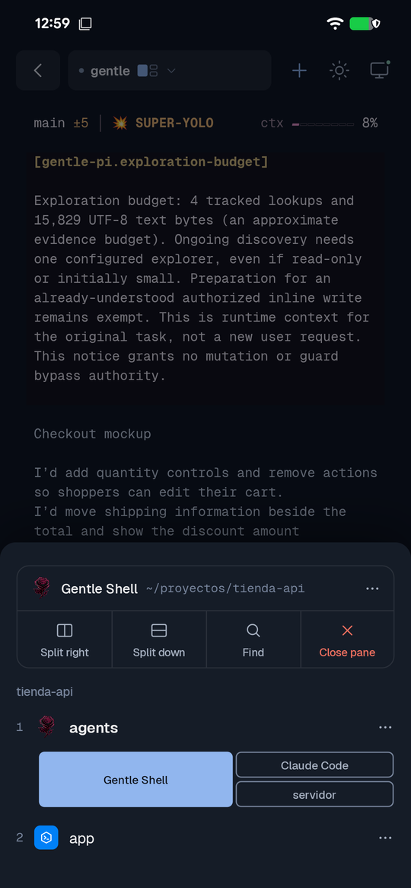
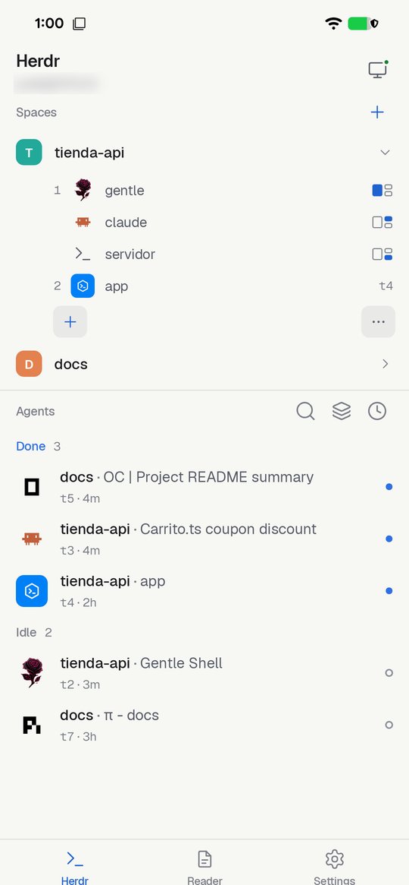
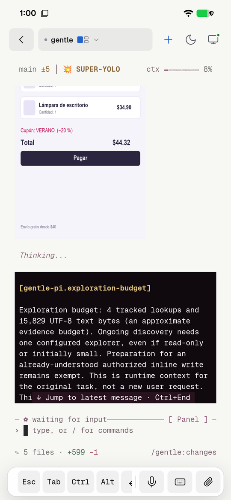
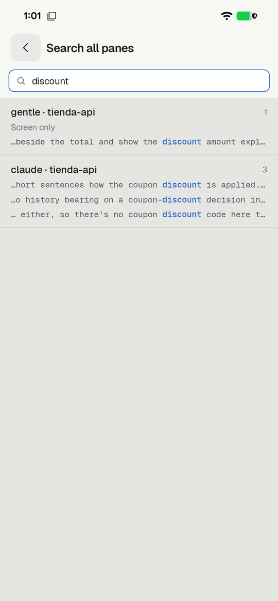

<p align="center"><a href="README.md">English</a> · <b>Español</b></p>

# Remote Shell

**Tus agentes de IA, en tu bolsillo.** Remote Shell es una app para iPhone y Android que lleva tu workspace de
[herdr](https://herdr.dev) al teléfono: cada agente, cada panel y sus respuestas, todo en una sola app.

Arranca un agente en tu máquina, aléjate y sigue trabajando desde el teléfono: ve quién está trabajando, quién terminó y quién te
necesita, lee o escucha la respuesta, dicta el siguiente prompt y envíalo.

<p align="center"><a href="https://apps.apple.com/app/id6838730267">App Store</a> · <a href="https://play.google.com/store/apps/details?id=com.yudelsuarez.remoteshell">Google Play</a></p>

<p align="center">
  
  
  
  
  
</p>
<p align="center">
  
  
  
  
  
</p>

## Qué hace

- **Todos tus agentes de un vistazo.** Claude Code, Codex, OpenCode, pi, Gentle Shell y más, cada uno con su ícono y su estado en
  vivo (trabajando, listo, te necesita). Te avisa cuando un agente termina o te pide algo,
  mientras la app está abierta o lleva poco en segundo plano.
- **Tus paneles como los dejaste.** Un mapa con la distribución de cada tab. Toca un panel para abrirlo, desliza al siguiente,
  abre una terminal nueva o un agente nuevo en cualquier space.
- **Una terminal de verdad.** Terminal a todo color con barra de teclas (Esc, Tab, Ctrl, flechas), un D-pad flotante con
  esquinas configurables, tus propios atajos y soporte para teclado físico.
- **Imágenes dentro de la terminal.** Cuando un agente muestra una imagen, aparece ahí mismo. Tócala para verla en pantalla
  completa, amplíala, márcala con el dedo y envíasela a cualquier agente.
- **Dictado que puedes ver.** Habla en vez de escribir: el texto aparece en vivo en un borrador que puedes corregir antes de
  enviarlo. Por defecto, el dictado se hace en el propio teléfono.
- **Te lee las respuestas.** "Leer desde aquí" lee en voz alta la respuesta de un agente, marcando lo que falta y la frase que
  está sonando. Usa las voces del teléfono, una voz en la nube (OpenAI, ElevenLabs, Azure, Fish Audio, Inworld) o tu propio
  servidor.
- **Busca en todos los paneles a la vez.** Encuentra ese mensaje de error entre todos tus agentes y ve directo a él.
- **Hecha para las dos plataformas.** La misma app y el mismo comportamiento en iPhone y Android, en inglés y español, en claro
  y oscuro.

## Qué necesitas

- Una máquina con [herdr](https://herdr.dev) en macOS, Linux o Windows (la app habla con `hc`, la herramienta de línea de
  comandos de herdr).
- SSH activado en la máquina. El teléfono se conecta desde la red de tu casa, o desde cualquier lugar con
  [Tailscale](docs/getting-started.es.md#úsala-fuera-de-casa) u otra VPN, sin abrir ningún puerto en tu router.
- Un iPhone o iPad con iOS 16 o posterior, o un teléfono Android con Android 13 o posterior.

Configuración paso a paso: [Primeros pasos](docs/getting-started.es.md).

## Seguridad y privacidad

Remote Shell se conecta **directo** de tu teléfono a tu máquina por SSH. No hay ningún servidor en medio, ni cuentas, ni
analítica ni rastreo. El teléfono crea su propia llave, guardada en el almacenamiento seguro del sistema, y la identidad de la
máquina queda fijada. Las voces y el dictado en la nube son opcionales y usan tus propias claves.

Los detalles y qué datos van a dónde: [Seguridad y privacidad](docs/security-and-privacy.es.md). Para reportar una
vulnerabilidad, mira [SECURITY.md](SECURITY.md).

## Compilar desde el código

La app está hecha con [.NET MAUI](https://dotnet.microsoft.com/apps/maui); la terminal es [xterm.js](https://xtermjs.org) dentro
de una vista web.

```sh
# Requisitos: SDK de .NET 10 con la carga de MAUI; Xcode para iOS; Android SDK para Android; Node.js para recompilar la terminal.
cd HerdrRemote/terminal-web && ./build.sh             # solo si cambias el código de la terminal
cd ../HerdrRemote
dotnet build -f net10.0-android -c Debug              # Android
dotnet build -f net10.0-ios -c Debug                  # iOS (para el simulador no hace falta firma)
```

**Para instalarla en tu propio iPhone.** El repositorio no trae ninguna identidad de firma. Crea
`HerdrRemote/HerdrRemote/Signing.local.props` (git lo ignora) con tus propios datos:

```xml
<Project>
  <PropertyGroup Condition="'$(TargetFramework)'=='net10.0-ios' and '$(Configuration)'=='Debug'">
    <CodesignKey>Apple Development: Tu Nombre (TEAMID)</CodesignKey>
    <CodesignProvision>Nombre de tu perfil de aprovisionamiento</CodesignProvision>
  </PropertyGroup>
</Project>
```

Si publicas tu propia versión, cambia también el identificador de la app (`ApplicationId` en el archivo del proyecto) y el grupo
del llavero en `Platforms/iOS/Entitlements.plist`, y dale a la app su propio nombre e ícono (mira Licencia).

## Preguntas frecuentes

<details>
<summary><b>¿Funciona sin herdr?</b></summary>

No. Remote Shell acompaña a [herdr](https://herdr.dev): muestra y controla los workspaces, agentes y terminales que herdr
tiene abiertos en tu máquina.
</details>

<details>
<summary><b>¿Mi código pasa por algún servidor?</b></summary>

No. El teléfono se conecta directo a tu máquina por SSH. Solo las voces y el dictado en la nube, que son opcionales, envían algo a
otro lugar, y solo al proveedor que elijas. Mira [Seguridad y privacidad](docs/security-and-privacy.es.md).
</details>

<details>
<summary><b>¿La puedo usar fuera de casa? ¿Tengo que abrir un puerto?</b></summary>

Sí puedes, y no hace falta. Pon el teléfono y la máquina en la misma red privada con [Tailscale](https://tailscale.com)
(gratis para uso personal) u otra VPN, y conéctate al nombre o la dirección de Tailscale de la máquina. No abres nada en tu
router, funciona aunque tu proveedor de internet comparta una IP pública entre muchos clientes (CGNAT) y SSH nunca queda
expuesto a internet: solo tus propios equipos llegan a él, y el tráfico va cifrado de punta a punta aunque pase por un
relevo. Pasos: [Úsala fuera de casa](docs/getting-started.es.md#úsala-fuera-de-casa).
</details>

<details>
<summary><b>¿Por qué .NET MAUI?</b></summary>

Casi todo lo que hace útil a esta app vive en las APIs nativas de cada teléfono: el reconocimiento de voz en el propio
dispositivo, el motor de audio que lee las respuestas, el almacenamiento seguro de llaves, el trabajo en segundo plano en
Android y los avisos locales. Con .NET se puede llamar a cualquier API de iOS y Android directamente desde C#, y la conexión
SSH corre dentro de la app con librerías maduras de .NET. Una sola base de código mantiene las dos plataformas iguales, en iOS
compila a código nativo y .NET 10 es una versión LTS (soporte a largo plazo). La terminal es xterm.js, el motor de la terminal de VS
Code, así que cada parte usa lo que mejor le va.

Además es el stack que el autor mejor conoce, con más de 30 años haciendo software, buena parte para empresas y para hardware
como dispositivos Bluetooth, donde C# da acceso completo a los SDK nativos de iOS y Android desde los tiempos de Xamarin.
Flutter y React Native también son muy buenas opciones; esta se eligió por lo que necesita esta app.
</details>

## Licencia

Copyright 2026 Yudel Suarez. Se distribuye bajo la [Licencia Apache 2.0](LICENSE) (el texto legal está en inglés).

La licencia cubre el código. El nombre y el ícono de **Remote Shell** no se licencian para forks ni apps derivadas: si publicas
tu propia versión, dale su propio nombre e ícono (sección 6 de la licencia).

Remote Shell es un proyecto independiente. No está afiliado a herdr, Anthropic (Claude Code), OpenAI (Codex), OpenCode,
Gentleman Programming (Gentle Shell) ni a ninguna otra herramienta con la que funciona, ni cuenta con su respaldo. Sus nombres y logos pertenecen a
sus dueños y aparecen solo para mostrar qué agente está corriendo.

Componentes de terceros y sus licencias: [THIRD-PARTY-NOTICES.md](THIRD-PARTY-NOTICES.md).
