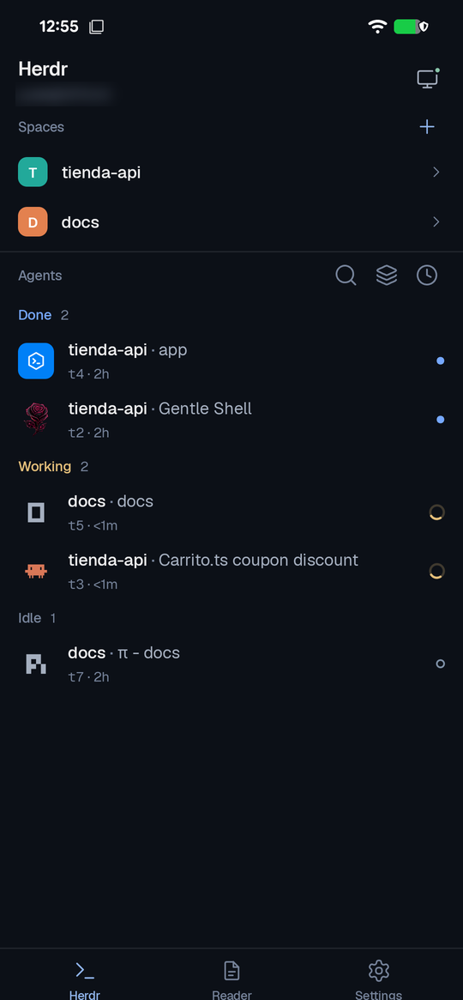
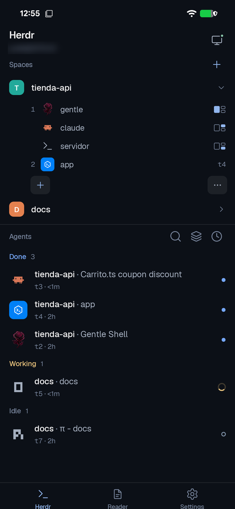
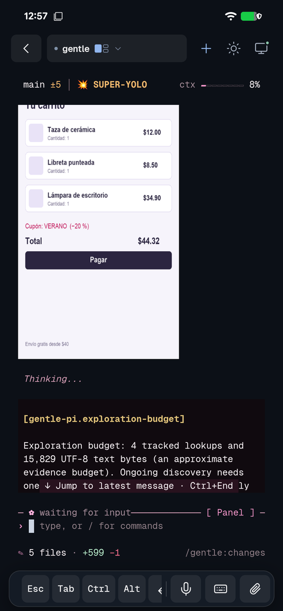
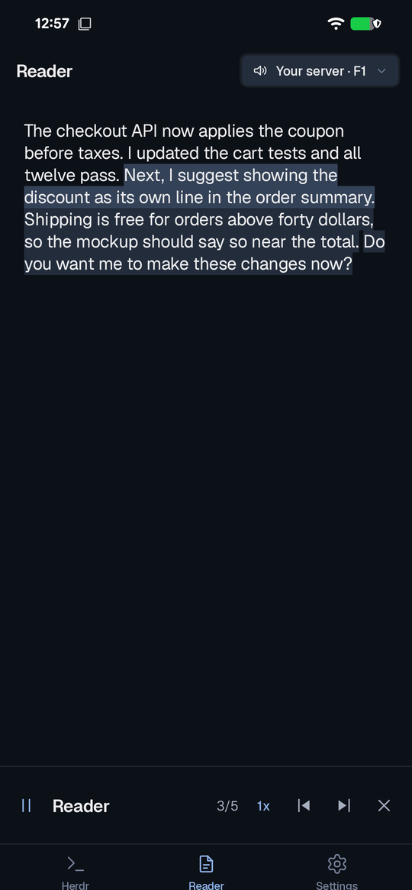
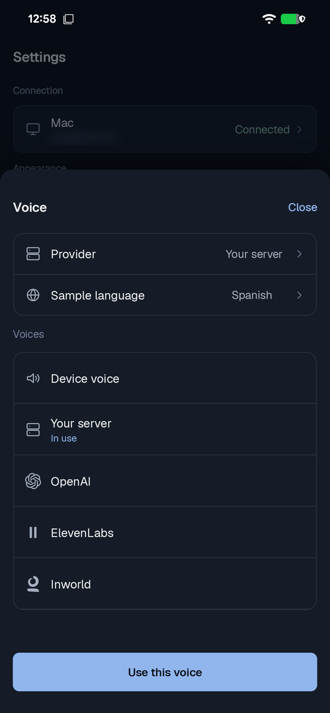
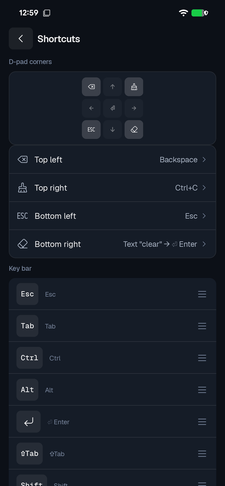
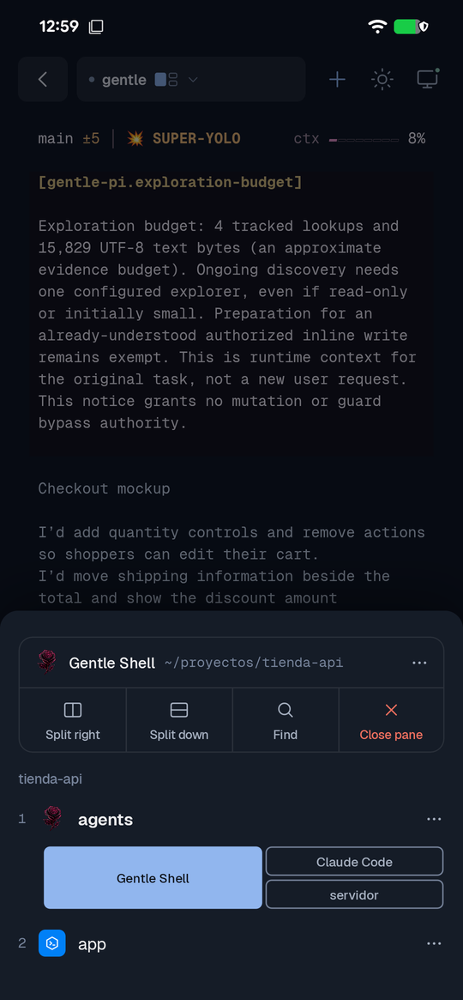
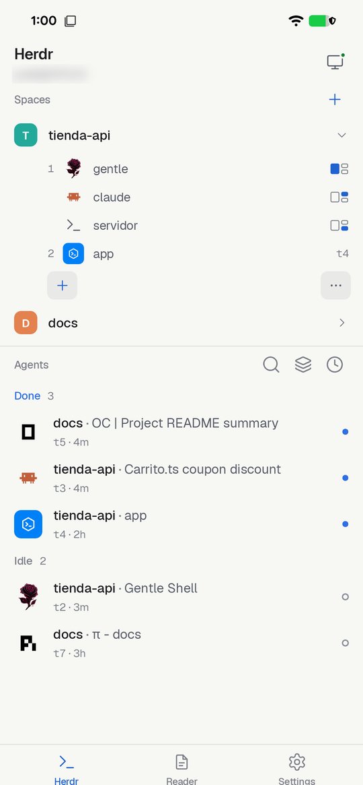
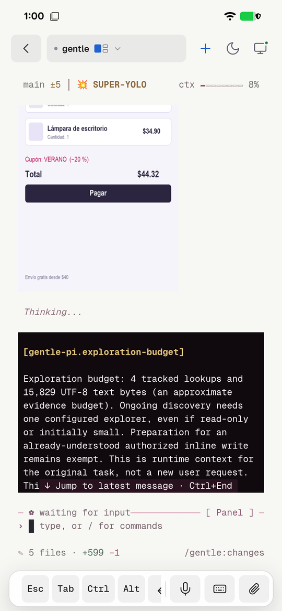
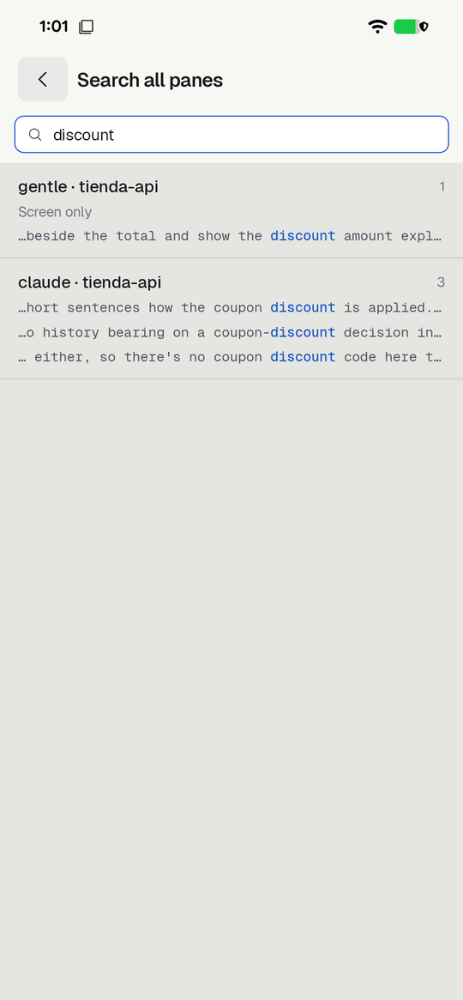

<p align="center"><b>English</b> · <a href="README.es.md">Español</a></p>

# Remote Shell

**Your AI coding agents, in your pocket.** Remote Shell is a mobile app for iPhone and Android that puts your
[herdr](https://herdr.dev) workspace on your phone: every agent, every pane, and their replies, all in one app.

Start an agent on your Mac, walk away, and keep working from the phone: see who is working, who is done and who needs you,
read or listen to the answer, dictate the next prompt, and send it back.

> **Status:** beta. The App Store and Google Play releases are on the way; until then you can build it from source.

<p align="center">
  
  
  
  
  
</p>
<p align="center">
  
  
  
  
  
</p>

## What it does

- **Every agent at a glance.** Claude Code, Codex, OpenCode, pi, Gentle Shell and more, each with its own icon and live state
  (working, done, needs you). Get a notification when an agent finishes or asks for you
  while the app is open or recently in the background.
- **Your panes as you left them.** A map of each tab's layout. Tap a pane to open it, swipe to the next one, start a new
  terminal or a new agent in any space.
- **A real terminal.** Full-color terminal with a key bar (Esc, Tab, Ctrl, arrows), a floating D-pad with programmable corners,
  your own shortcuts, and hardware keyboard support.
- **Images inside the terminal.** When an agent shows an image, it appears inline. Tap it to open it full screen, zoom in, draw
  on it to mark what you mean, and send it back to any agent.
- **Dictation you can see.** Talk instead of typing: the text appears live in a draft you can edit before sending. Dictation
  runs on the phone by default.
- **It reads to you.** "Read from here" reads an agent's reply aloud, marking what is still to come and the sentence being
  spoken. Choose the phone's own voices or a cloud voice (OpenAI, ElevenLabs, Azure, Fish Audio, Inworld) or your own server.
- **Search every pane at once.** Find that error message across all your agents and jump straight to it.
- **Made for both platforms.** The same app, the same behavior, on iPhone and Android, in English and Spanish, light and dark.

## What you need

- A Mac running [herdr](https://herdr.dev) (the app talks to `hc`, herdr's command line tool).
- **Remote Login** turned on in the Mac's System Settings (Sharing), so the phone can reach it over SSH.
- An iPhone or iPad with iOS 16 or later, or an Android phone with Android 13 or later, on the same network as the Mac
  (or reachable through your VPN).

Step-by-step setup: [Getting started](docs/getting-started.md).

## Security and privacy

Remote Shell connects **directly** from your phone to your Mac over SSH. There is no server in between, no account, and no
analytics or tracking. The phone creates its own key, stored in the system's secure storage, and the Mac's identity is pinned.
Cloud voices and cloud dictation are optional and use your own API keys.

The details, and what data goes where: [Security and privacy](docs/security-and-privacy.md). To report a vulnerability, see
[SECURITY.md](SECURITY.md).

## Build from source

The app is built with [.NET MAUI](https://dotnet.microsoft.com/apps/maui); the terminal is [xterm.js](https://xtermjs.org)
in a web view.

```sh
# Requirements: .NET 10 SDK with the MAUI workload; Xcode for iOS; Android SDK for Android; Node.js to rebuild the terminal.
cd HerdrRemote/terminal-web && ./build.sh             # only after changing the terminal code
cd ../HerdrRemote
dotnet build -f net10.0-android -c Debug              # Android
dotnet build -f net10.0-ios -c Debug                  # iOS (simulator builds need no signing)
```

**Building for your own iPhone.** The repository ships without a signing identity. Create `HerdrRemote/HerdrRemote/Signing.local.props`
(it is ignored by git) with your own values:

```xml
<Project>
  <PropertyGroup Condition="'$(TargetFramework)'=='net10.0-ios' and '$(Configuration)'=='Debug'">
    <CodesignKey>Apple Development: Your Name (TEAMID)</CodesignKey>
    <CodesignProvision>Your provisioning profile name</CodesignProvision>
  </PropertyGroup>
</Project>
```

If you publish your own build, also change the app identifier (`ApplicationId` in the project file) and the keychain group in
`Platforms/iOS/Entitlements.plist`, and give the app its own name and icon (see License).

## FAQ

<details>
<summary><b>Does it work without herdr?</b></summary>

No. Remote Shell is a companion for [herdr](https://herdr.dev): it shows and controls the workspaces, agents and terminals
that herdr runs on your Mac.
</details>

<details>
<summary><b>Does my code go through any server?</b></summary>

No. The phone connects straight to your Mac over SSH. Only the optional cloud voices and cloud dictation send anything
elsewhere, and only to the provider you pick. See [Security and privacy](docs/security-and-privacy.md).
</details>

<details>
<summary><b>Why .NET MAUI?</b></summary>

Most of what makes this app useful lives in each phone's native APIs: on-device speech recognition, the audio engine that
reads replies aloud, the secure key storage, background work on Android and local notifications. With .NET, every iOS and
Android API can be called directly from C#, and the SSH connection runs inside the app with mature .NET libraries. One
codebase keeps both platforms behaving the same, iOS builds compile to native code, and .NET 10 is a long-term support
release. The terminal itself is xterm.js, the engine behind VS Code's terminal, so each part uses what fits it best.

It is also the stack the author knows best, after more than 30 years of building software, much of it for business and for
hardware such as Bluetooth devices, where C# has given full access to the native iOS and Android SDKs since the Xamarin days.
Flutter and React Native are excellent choices too; this one was picked for this app's needs.
</details>

## License

Copyright 2026 Yudel Suarez. Licensed under the [Apache License 2.0](LICENSE).

The license covers the code. The **Remote Shell** name and icon are not licensed for use by forks or derived apps: if you
publish your own version, please give it its own name and icon (see section 6 of the license).

Remote Shell is an independent project. It is not affiliated with, or endorsed by, herdr, Anthropic (Claude Code), OpenAI
(Codex), OpenCode, Gentleman Programming (Gentle Shell) or any other tool it works with. Their names and logos belong to their
owners and appear only to show which agent is running.

Third-party components and their licenses: [THIRD-PARTY-NOTICES.md](THIRD-PARTY-NOTICES.md).
